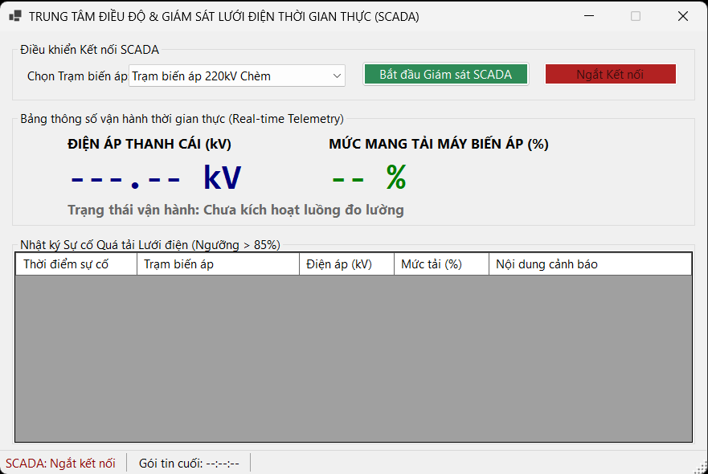
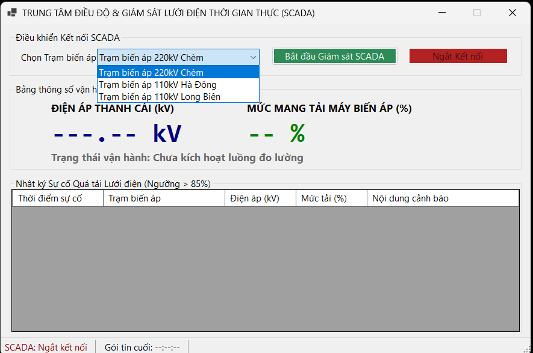
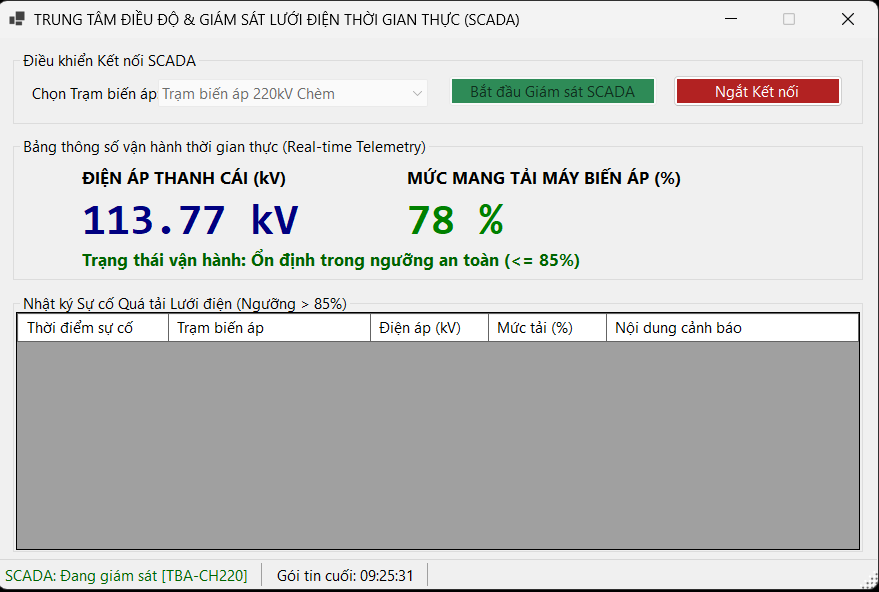

# BÁO CÁO BÀI TẬP

## THÔNG TIN SINH VIÊN
- **Họ và tên:** Phạm Huy Hoàng
- **Mã số sinh viên:** 24810340415
- **Lớp:** D19CNPM3
- BÀI TẬP 6.7: TRUNG TÂM ĐIỀU ĐỘ & GIÁM SÁT LƯỚI ĐIỆN THỜI GIAN THỰC (CROSS-THREAD SAFETY)

---

## MỤC ẢNH KẾT QUẢ CHỨC NĂNG
### 1. Màn hình Chính / Tổng quan hệ thống:

### 2. Màn hình Quản lý Danh mục (CRUD - Thêm/Sửa/Xóa):

### 3. Màn hình Thực thi Nghiệp vụ chính (Lập Hóa đơn / Bán hàng / Chấm công / Đặt phòng):

